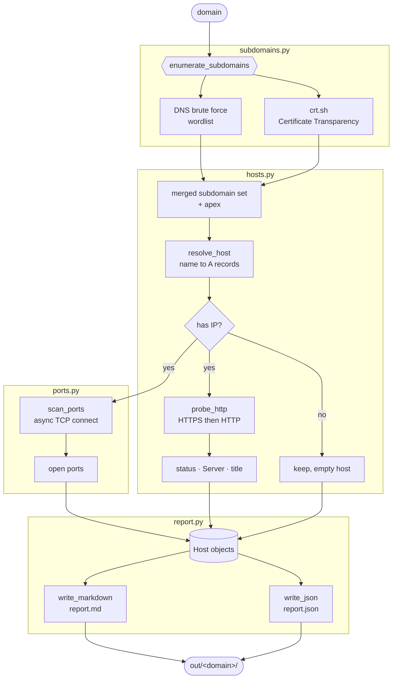

# asm — Attack Surface Mapper

A reconnaissance tool that maps the external attack surface of a domain: subdomains, live hosts, technology hints, and open ports. Results are written as both machine-readable JSON and a human-readable Markdown report.

> **Authorized use only.** Run this only against domains and hosts you own or have explicit written permission to test. Unauthorized scanning may be illegal in your jurisdiction. The author assumes no liability for misuse.

## What it does

Given a target domain, `asm` runs a pipeline:

1. **Subdomain enumeration** — pulls known subdomains from Certificate Transparency logs (crt.sh) and optionally brute-forces a wordlist against DNS.
2. **Resolution** — resolves each candidate to its A records, dropping those that do not resolve.
3. **Liveness** — probes resolved hosts over HTTP and HTTPS, capturing status code, title, and `Server` header.
4. **Port scan** — a lightweight async TCP connect scan over a configurable port set (default: top 100).
5. **Reporting** — emits `report.json` and `report.md`.

The stages are deliberately decoupled so each can be swapped for a heavier external tool later (e.g. `subfinder`, `httpx`, `nuclei`).

## Pipeline



Each I/O-bound stage fans out under an `asyncio` semaphore. A failing source (for example a `502` from crt.sh) is caught and the pipeline continues with whatever the other stages produced.

## Architecture

```
asm/
  cli.py          argument parsing, orchestration
  models.py       dataclasses for the result graph
  subdomains.py   crt.sh + DNS brute enumeration
  hosts.py        DNS resolution + HTTP(S) liveness probing
  ports.py        async TCP connect scanner
  report.py       JSON + Markdown writers
```

Everything I/O-bound runs on `asyncio` with a bounded semaphore so you control concurrency and stay polite to targets.

## Install

```bash
cd hac
python3 -m venv .venv
source .venv/bin/activate
pip install -r requirements.txt
```

## Usage

```bash
# Minimal: CT-log subdomains, liveness, top-100 ports
python -m asm example.com

# Add DNS brute force with a wordlist
python -m asm example.com --wordlist wordlists/subdomains-small.txt

# Tune concurrency and port set
python -m asm example.com --concurrency 50 --ports 1-1024

# Choose output directory
python -m asm example.com --out ./out/example.com
```

### Key flags

| Flag | Default | Meaning |
|------|---------|---------|
| `--wordlist PATH` | none | enable DNS brute force with this wordlist |
| `--ports SPEC` | `top100` | `top100`, `1-1024`, or `80,443,8080` |
| `--concurrency N` | `30` | max in-flight network operations per stage |
| `--timeout S` | `5.0` | per-connection timeout in seconds |
| `--out DIR` | `./out/<domain>` | output directory |
| `--no-ports` | off | skip the port scan stage |

## Output

- `report.json` — full result graph; feed it into the next tool.
- `report.md` — readable summary with a table per host.

## Roadmap

- [ ] Passive DNS source beyond crt.sh
- [ ] Technology fingerprinting from response bodies
- [ ] Pluggable external tool adapters (`subfinder`, `httpx`)
- [ ] Rate-limit backoff on crt.sh

## License

MIT. See `LICENSE`.
